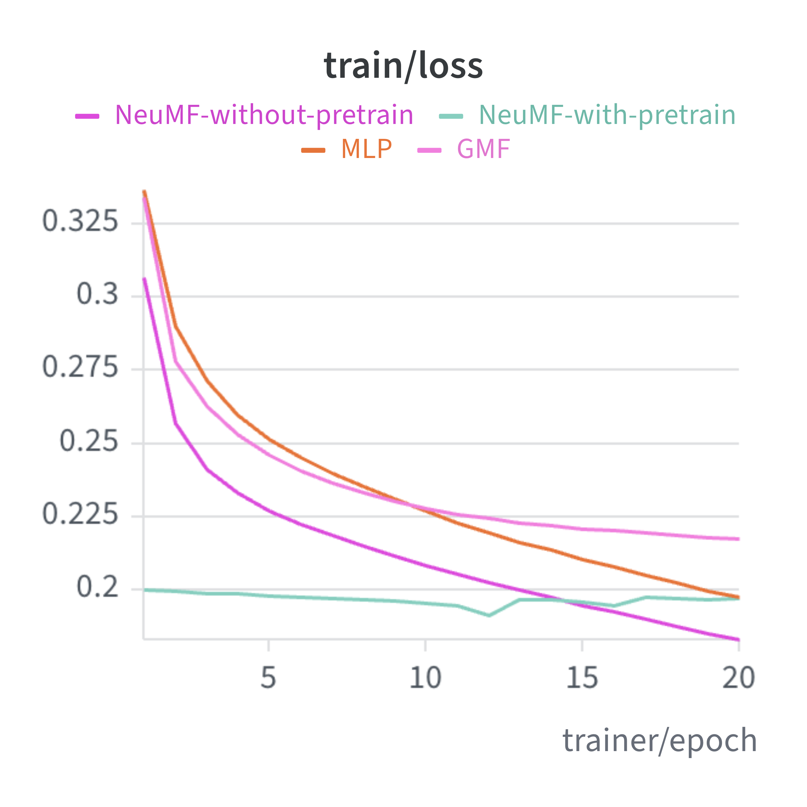
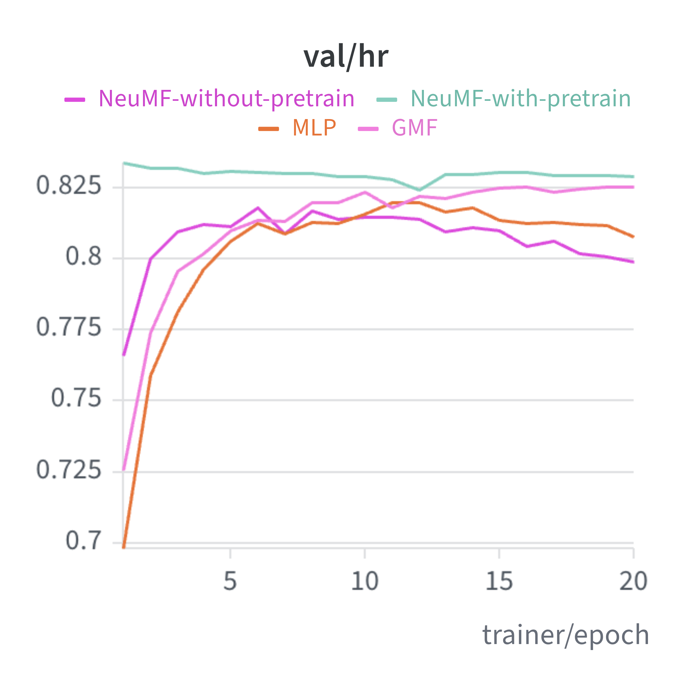
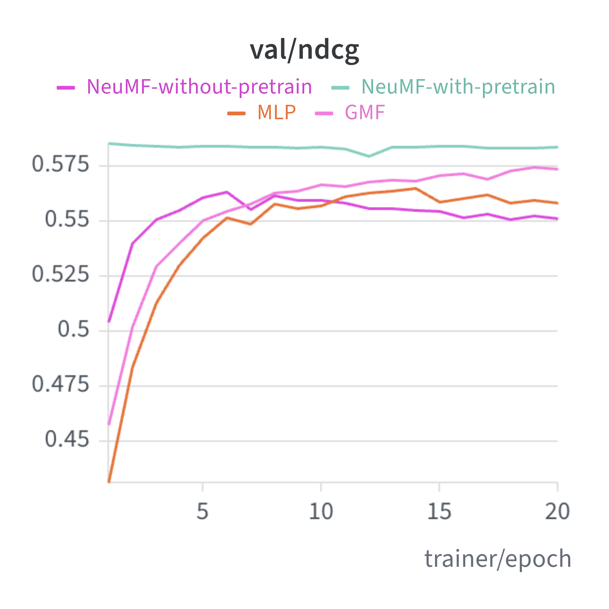
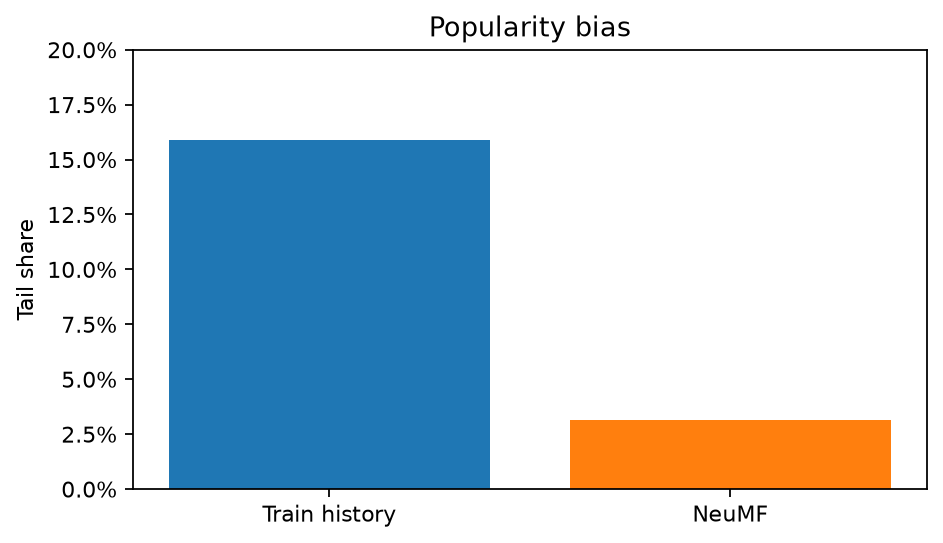
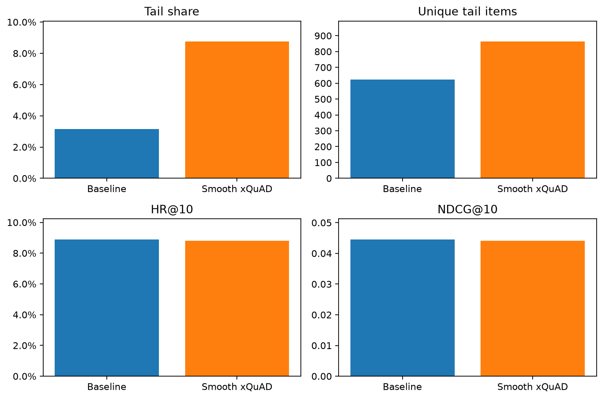

# Neural Collaborative Filtering の再現と人気度の偏りの改善

MovieLens 1M で NeuMF を再現し、人気作品に偏った推薦を **Smooth xQuAD** で調整する。
[分析スクリプト](popularity_reranking/neumf_popularity_bias.py) に、推論から図の作成までをまとめた。

## 再現実装にあたっての注意点

本リポジトリは、普段論文再現実装を管理しているリポジトリから、Neural Collaborative Filteringの再現実装を、`git filter-repo` で関連するコミット履歴とともに切り出したものです。元リポジトリのルートで管理していた依存関係の定義や `.gitignore` は抽出対象に含まれないため、切り出し後に追加・調整しています。

参考にしたリポジトリは次の2つ。

- [公式実装：hexiangnan/neural_collaborative_filtering](https://github.com/hexiangnan/neural_collaborative_filtering)：モデルの構成、初期化、事前学習の方法を確認。
- [PyTorch 版再現実装：guoyang9/NCF](https://github.com/guoyang9/NCF)：PyTorch での実装と学習設定を参考にした。

主に PyTorch 版から、次の点を変更した。

- **モデルのクラスを整理**：1つの `NCF` クラス内での切り替えを、`GMF`・`MLP`・`NeuMF` と共通の Encoder に分け、構成と重みの引き継ぎを読み取りやすくした。
- **val と test を分離**：学習データから各ユーザー1件を val に取り分け、val の HR でモデルを選択する。test は選択したモデルの最終評価に使う。

本編のモデルは参考実装の設定をもとに固定し、**モデルのハイパーパラメータ探索は行っていない**。
埋め込み次元の基準値32、MLP 3層、学習率0.001、バッチサイズ256、学習時の負例数4を使用した。
後述する再ランキングの係数 λ だけは val で選ぶ。

再現確認は「正例1件＋負例99件」、第2節以降の追加実験は**全3,706作品から学習済み作品を除いた候補**で評価する。

## 1. 再現実装結果

MovieLens 1M の「正例1件＋負例99件」から上位10件を推薦し、HR@10・NDCG@10 を比較した。

| モデル | 原論文 HR@10 | 原論文 NDCG@10 | 第三者実装 HR@10 | 第三者実装 NDCG@10 | 本実装 HR@10 | 本実装 NDCG@10 |
| --- | ---: | ---: | ---: | ---: | ---: | ---: |
| GMF | — | — | 0.708 | 0.429 | 0.7020 | 0.4264 |
| MLP | 0.692 | 0.425 | 0.691 | 0.416 | 0.6902 | 0.4149 |
| NeuMF（事前学習なし） | 0.701 | 0.425 | 0.701 | 0.424 | 0.6925 | 0.4170 |
| NeuMF（事前学習あり） | 0.726 | 0.445 | 0.720 | 0.439 | **0.7089** | **0.4315** |

原論文の値は [He et al., WWW 2017](https://arxiv.org/pdf/1708.05031) の表2〜4（Factors=32、MLPは3層）から引用した。GMF は図4での掲載のみのため、数値の転記を省略した。
第三者実装の値は [guoyang9/NCF の README](https://github.com/guoyang9/NCF#readme) に掲載された PyTorch 版の結果。
本実装の値は `outputs/fixed-val-20261122-154335` 内の各モデルの `train.log` に記録された最終 test 結果で、seed 42・20 epochのうち val の HR が最良のモデルを使用した。
本実装では学習データから val を別途取り分けているため、学習データ量とモデル選択の条件は比較先と異なる。

### 学習曲線と簡単な考察

横軸は epoch。HR・NDCG は val の値で、上の表の test 結果とは区別する。

| 学習損失 | val HR@10 | val NDCG@10 |
| --- | --- | --- |
|  |  |  |

- **事前学習ありNeuMF**：最初から損失が低く、val 指標も高い。追加学習による変化は小さく、val の HR は1 epoch目が最良だった。
- **事前学習なしNeuMF**：損失は下がり続ける一方、val の HR・NDCG は6 epoch付近をピークに低下しており、やや過学習の傾向が見られる。
- **比較結果**：原論文・第三者実装にはやや届かなかったが、事前学習ありNeuMF が最も高い test 精度となり、事前学習の有効性を確認できた。

## 2. 人気度の偏り

人気度を学習データ内の出現回数で定義し、累積出現回数の約80%を占める作品を「人気作品」、残りを「低人気作品」とする。
ユーザーの履歴では低人気作品が平均 **15.88%** を占める一方、NeuMF の推薦10件では **3.16%** にとどまった。



履歴はユーザーごとの割合を平均した値。推薦では人気作品への偏りが強まっている。

## 3. Smooth xQuAD による調整

NeuMF の関連度上位100件から、履歴と推薦済みリストの構成を考慮して10件を選び直す。

1. 各ユーザーの履歴から、人気・低人気作品の比率を求める。
2. 履歴での比率に対して、推薦リストに十分含まれていないカテゴリへボーナスを付ける。
3. **元の関連度 ＋ λ × ボーナス** が高い作品を1件ずつ選ぶ。

再学習せず、ユーザーの履歴を考慮して低人気作品の推薦機会を増やす。
λ は val の HR・NDCG の低下をそれぞれ絶対値0.005以内に抑えた候補から、低人気作品の推薦枠が最大となる **0.8** を選択した。
手法は [Abdollahpouri et al., FLAIRS 2019](https://cdn.aaai.org/ocs/18199/18199-78818-1-PB.pdf) に基づく。

## 4. 改善結果

MovieLens 1M／6,040ユーザー／seed 42／推薦10件。同じ NeuMF に再ランキングを適用した。



低人気作品の推薦枠は **3.16% → 8.75%**、推薦された低人気作品数は **622 → 863作品** に増加した。
全体の HR@10 は **8.89% → 8.81%**、NDCG@10 は **0.04453 → 0.04404** とわずかに低下した。
精度の低下を抑えつつ、低人気作品への推薦機会を広げることができた。

## 課題・今後の展望

- **モデルのハイパーパラメータ探索**：埋め込み次元、層数、学習率、負例数を調整し、推薦精度を高める。
- **候補生成の改善**：現在の上位100件に入りにくい低人気作品も候補に含め、再ランキングで選べる範囲を広げる。
- **精度と推薦機会の両立**：候補数や補正の強さ、関連度スコアの調整を検討し、精度低下を抑えながら低人気作品の露出を増やす。

## 実行方法と構成

以下のコマンドは、リポジトリのルートディレクトリで実行する。
データと学習済みモデルはリポジトリに含まれないため、別途配置するか、以下の手順で学習する。

### 1. 環境構築

Python 3.12以降と [uv](https://docs.astral.sh/uv/) を使用する。
依存関係は `pyproject.toml` と `uv.lock` で管理している。

以下は CUDA 12.6 版の PyTorch を利用する場合の例。

```bash
uv sync --python 3.12 --extra cu126
```

以降の実行例も `--extra cu126` を指定する。
CUDA 13.0 版を利用する場合は、環境に合わせて `cu130` に置き換える。

### 2. データの準備

[公式実装の Data ディレクトリ](https://github.com/hexiangnan/neural_collaborative_filtering/tree/master/Data) から、加工済み MovieLens 1M の次の2ファイルを取得し、`data/` に配置する。

```text
data/
├── ml-1m.train.rating
└── ml-1m.test.negative
```

`ml-1m.test.negative` の先頭列にある正例を使用するため、`ml-1m.test.rating` は不要。
val は `ml-1m.train.rating` から各ユーザー1件を取り分けて作成する。

### 3. 学習設定の準備

設定例をコピーする。

```bash
cp conf/config.example.yaml conf/config.yaml
```

`conf/config.yaml` 内の対応する項目を次のように設定する。
その他の項目は設定例のまま使用する。

```yaml
data:
  base_dir: .
  batch_size: 256
  num_workers: 1

output:
  root_dir: ./outputs

wandb:
  enabled: false
```

`data.base_dir` は `data/` を含むディレクトリを指定する。
モデルの設定は、次の学習コマンドで上書きする。

W&B を利用する場合は `wandb.enabled: true` とし、`wandb.project`・`wandb.entity` を利用先に合わせて設定する。
オンラインで記録する場合は、事前にログインする。

```bash
uv run --extra cu126 wandb login
```

### 4. モデルの学習

seed 42、20 epochで、GMF・MLP・事前学習ありNeuMF・事前学習なしNeuMFを学習する。
以下では保存先を `outputs/reproduction/` とする。

まず GMF と MLP を学習する。

```bash
uv run --extra cu126 python train.py \
  model.model_name=GMF \
  model.use_pretrain=false \
  hydra.run.dir=outputs/reproduction/GMF

uv run --extra cu126 python train.py \
  model.model_name=MLP \
  model.use_pretrain=false \
  hydra.run.dir=outputs/reproduction/MLP
```

保存された GMF・MLP のチェックポイントを使用して、事前学習ありNeuMFを学習する。

```bash
uv run --extra cu126 python train.py \
  model.model_name=NeuMF \
  model.use_pretrain=true \
  model.gmf_checkpoint_path=outputs/reproduction/GMF/checkpoint.pt \
  model.mlp_checkpoint_path=outputs/reproduction/MLP/checkpoint.pt \
  hydra.run.dir=outputs/reproduction/NeuMF-pre
```

事前学習なしNeuMFは次のように実行する。

```bash
uv run --extra cu126 python train.py \
  model.model_name=NeuMF \
  model.use_pretrain=false \
  hydra.run.dir=outputs/reproduction/NeuMF-no-pre
```

各モデルの出力先に、val の HR が最良だった `checkpoint.pt` と、実行時の設定 `.hydra/config.yaml` が保存される。
学習終了後、そのチェックポイントを読み込んで test を評価する。

### 5. 人気度の分析と再ランキング

事前学習ありNeuMFの保存済みモデルと設定を使用する。
上記の学習手順を実行した場合、必要なファイルの配置は次のようになる。

```text
outputs/reproduction/
└── NeuMF-pre/
    ├── checkpoint.pt
    └── .hydra/
        └── config.yaml
```

`--run-dir` には `NeuMF-pre/` を含むディレクトリを指定する。

```bash
uv run --extra cu126 python popularity_reranking/neumf_popularity_bias.py \
  --run-dir outputs/reproduction
```

掲載結果には、既存の `outputs/fixed-val-20261122-154335` の保存済みモデルを使用した。
そのモデルを配置して分析する場合は、`--run-dir` を同ディレクトリに変更する。

データが別の場所にある場合は、`data/` を含むディレクトリを `--data-dir` で指定する。
`--batch-size` で推論バッチサイズを変更できる（既定値8192）。

実行時のカレントディレクトリにかかわらず、図2枚をプロジェクトの `docs/` に保存する。
ファイル名は `popularity_bias.png` と `reranking_results.png`。
集計結果は標準出力に表示し、CSV や推薦リストは別ファイルに保存しない。

### 構成

- `conf/config.example.yaml`：学習設定のひな形。
- `ncf_reproduction/`：NCF の再現実装。
- `train.py`：モデルの学習と最良チェックポイントでの test 評価。
- [popularity_reranking/reranking.py](popularity_reranking/reranking.py)：Smooth xQuAD と係数選択。
- [popularity_reranking/neumf_popularity_bias.py](popularity_reranking/neumf_popularity_bias.py)：推論・係数選択・評価・図の保存。
- `docs/`：README で使用する図。
